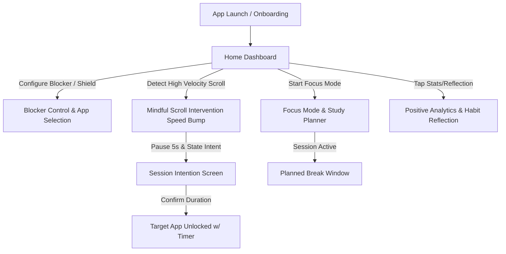

# Low-Fidelity Wireframes & User Navigation Flow

This document details the screen layout wireframes and navigation architecture for the **ScrollBrake** application.

---

## 1. Core User Navigation Flow



---

## 2. Screen Layout Wireframes

### Screen 1: Home Dashboard (`HomeActivity`)
```
+-------------------------------------------------+
|  [≡]  ScrollBrake                [Attention 🪙 120] |
+-------------------------------------------------+
|                                                 |
|  🔥 Daily Streak: 5 Days                        |
|  [==========================] 80% to Goal        |
|                                                 |
|  +-------------------------------------------+  |
|  |  🎯 Quick Action: Focus Mode              |  |
|  |  [ Start 25 Min Study Session ]           |  |
|  +-------------------------------------------+  |
|                                                 |
|  📱 Monitored Apps (3 Active):                  |
|  - Instagram  [Velocity Intervention: ON]       |
|  - TikTok     [Velocity Intervention: ON]       |
|  - YouTube    [Velocity Intervention: ON]       |
|                                                 |
|  +-------------------------------------------+  |
|  |  📊 Today's Mindful Pauses: 8 Interventions |  |
|  +-------------------------------------------+  |
|                                                 |
|  [ Home ]    [ Focus ]    [ Habits ]   [ Stats ]|
+-------------------------------------------------+
```

### Screen 2: Mindful Scroll Intervention Overlay (`ScrollInterventionActivity`)
```
+-------------------------------------------------+
|                                                 |
|                   🧘 PAUSE                      |
|                                                 |
|             Mindless Scroll Detected            |
|                                                 |
|          Take a deep breath (5s...)             |
|                  [ ⭕ 5 ]                        |
|                                                 |
|    "What is your intention for opening Instagram?" |
|                                                 |
|    [  Check specific message from Alex      ]   |
|                                                 |
|    Set time limit:                              |
|    ( ) 2 Mins   (•) 5 Mins   ( ) 10 Mins        |
|                                                 |
|    [ Continue Mindfully ]    [ Close App Now ]  |
|                                                 |
+-------------------------------------------------+
```

### Screen 3: Focus Session Planner (`FocusMode`)
```
+-------------------------------------------------+
|  [<-]  Study Session Focus                      |
+-------------------------------------------------+
|                                                 |
|                    25 : 00                      |
|                 FOCUS WINDOW                    |
|                                                 |
|  Topic: Computer Science Homework               |
|  Planned Break: 5 Mins after 25 Mins            |
|                                                 |
|  Blocking Mode:                                 |
|  (•) Mindful Speed Bump    ( ) Hard Lockout     |
|                                                 |
|  [ ▶ START FOCUS SESSION ]                      |
|                                                 |
|  +-------------------------------------------+  |
|  | Scheduled Focus Windows                   |  |
|  | • Mon-Fri 09:00 AM - 11:30 AM (Study)     |  |
|  +-------------------------------------------+  |
+-------------------------------------------------+
```

### Screen 4: Positive Habit & Reflection Dashboard (`AnalyticsScreen`)
```
+-------------------------------------------------+
|  [<-]  Habit Reflection & Analytics             |
+-------------------------------------------------+
|                                                 |
|   🏆 Weekly Focus Hours: 14.5 hrs               |
|   🪙 Attention Earned: 450 Tokens                |
|                                                 |
|   Mindful Interventions Accepted: 88%           |
|   [==============================>   ] 88%      |
|                                                 |
|   Intervention Trend:                           |
|   Mon: 🟢 🟢 🟢                                 |
|   Tue: 🟢 🟢 🔴 🟢                              |
|   Wed: 🟢 🟢 🟢 🟢                              |
|                                                 |
|   "You took 12 mindful pauses this week!"       |
|                                                 |
+-------------------------------------------------+
```
